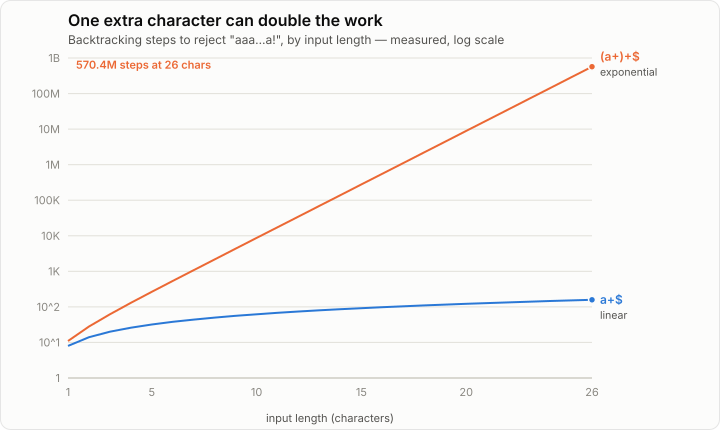
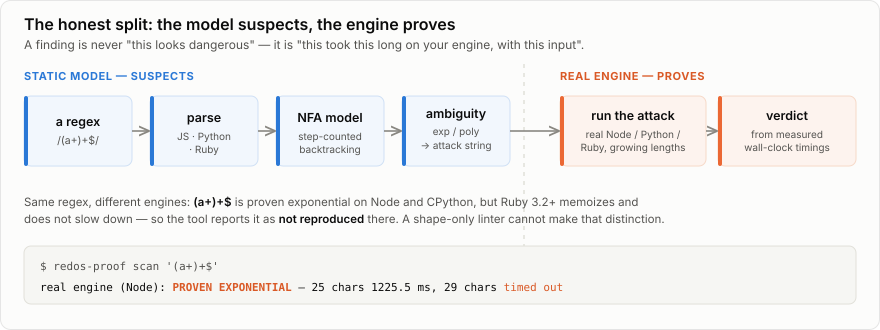

# redos-proof

Finds regular expressions that can freeze a program (ReDoS: catastrophic backtracking), and **proves** each
finding by building the input that makes it slow and running it on the real regex engine.

> **Status: complete (6 of 6 phases).** Point it at a codebase: it pulls the regexes out of JavaScript,
> TypeScript, Python and Ruby source, finds the vulnerable ones, and proves each by running the attack on the
> real engine. Ships a pre-commit hook, a GitHub Action and SARIF output, and is measured against a
> self-verifying corpus (100% recall, 0 false positives) and real repositories. Built on an exact model of how
> the three engines backtrack, checked against them.

<p align="center">
  
</p>

## Why

Some regular expressions take exponential time on the wrong input. `^(a+)+$` on `"aaaaaaaaaaaaaaaaaaaaaaaaaaaaaa!"`
makes JavaScript, Python, Ruby and Java try about a billion paths; one request can tie up a server. This took
down Stack Overflow in 2016 and Cloudflare in 2019, and npm alone has hundreds of advisories for it.

Existing linters mostly judge a pattern by its shape (`(a+)+` looks dangerous), so they raise alarms on safe
patterns and miss dangerous ones that do not look the part. redos-proof will report a pattern as vulnerable
only with the evidence attached: the attack string, and the measured blow-up on the real engine.

<p align="center">
  
</p>

| Phase | What | Status |
|---|---|---|
| 1 | Parser for JavaScript, Python and Ruby syntax; a model of their backtracking, step-counted; checked against the real engines | **done** |
| 2 | Static analysis: exponential and polynomial ambiguity, the attack string for each finding, confirmed by measurement | **done** |
| 3 | The proof: run each attack on real Node, Python and Ruby at growing lengths, verdict from the real timings | **done** |
| 4 | Scanner: regexes in source code across languages; CLI, SARIF, pre-commit hook, GitHub Action | **done** |
| 5 | Measurement: a self-verifying corpus (recall and precision), real repositories, placement among other tools | **done** |
| 6 | Figures, docs, polish | **done** |

## What works now

Scan a pattern for catastrophic backtracking. A finding comes with its proof: the attack input, and the
**real engine** timing out as the input grows. `scan` exits non-zero when the real engine reproduces the
blow-up, so it can gate CI or a pre-commit hook.

```bash
$ cargo run --release -- scan '(a+)+$'
VULNERABLE (backtracking model): EXPONENTIAL (one extra character can double the work)
  prefix   "aa"
  pump     "a"
  suffix   "!"
  example attack input (pump x20): "aaaaaaaaaaaaaaaaaaaaaa!"
  real engine (Node): PROVEN EXPONENTIAL
        13 chars       0.4 ms
        17 chars       4.6 ms
        21 chars      72.2 ms
        25 chars    1225.5 ms
        29 chars  timed out (still running after 2.5 s)
```

The same pattern is **not** dangerous on every engine, and the tool says so. Ruby 3.2+ memoizes to defeat most
of these, so `scan --dialect ruby '(a+)+$'` reports it as not reproduced (and exits 0), with a warning that
the pattern is still dangerous on an engine that does not. A tool that only looks at the pattern's shape gets
this wrong.

```bash
$ cargo run --release -- scan --dialect python '(?>a+)+$'    # atomic group: safe
no catastrophic backtracking found (not a guarantee of safety; see the limits in the docs)
```

Or scan a whole codebase — it pulls the regexes out of JavaScript, TypeScript, Python and Ruby source (skipping
`node_modules`, `.git`, and the like) and reports the vulnerable ones with their location:

```bash
$ cargo run --release -- files src/
src/app.js:1:12  EXPONENTIAL  /(a+)+$/
    attack: "aaaaaaaaaaaaaaaaaaaaaa!"
val.py:2:17  EXPONENTIAL  /(.*,)*$/
    attack: ",,,,,,,,,,,,,,,,,,,,!"

scanned 2 files, 3 regexes: 2 vulnerable
```

Add `--prove` to run each finding on the real engine, or `--sarif` for a GitHub code-scanning report. A
pre-commit hook (`hooks/pre-commit`) and a GitHub Action (`.github/actions/redos-proof`) are included.

Measure the detector against the corpus — every "vulnerable" entry is one the real engine actually blew up on,
so the labels cannot lie:

```bash
$ cargo run --release -- bench
...
vulnerable: 18/18 flagged by the model   (recall 100%)
            18/18 reproduced on the real engine
safe:       0/16 wrongly flagged   (precision 100%)
```

Under the hood, the step counter that proposes each finding:

```bash
cargo run --release -- steps '^(a+)+$' '' a '!'        # prefix, pumped string, suffix
```

```
       n            steps    ratio
       1               11
       2               28     2.55
       4              130     4.64
       8             2170    16.69
      16           557050   256.71      <- twice the input, 2^8 times the work: exponential
```

```bash
cargo run --release -- steps '^a+$' '' a '!'           # 2.00 per doubling: linear
cargo run --release -- match --dialect python '(?:|\w)*' 'ab'
```

The step count is the work a backtracking engine does, counted exactly rather than timed, so it is the same on
every machine.

## How it is checked

**Differential testing against the real engines.** A generator builds random patterns (groups, alternation,
every quantifier with lazy and possessive forms, anchors, word boundaries, lookahead and lookbehind, atomic
groups, flags) and random inputs (ASCII plus characters where the engines' Unicode rules differ). Each is run
through the model and through real Node 22, Python 3.11 and Ruby 3.3, and every match position must agree.

| Engine | Matches compared (3 seeds) | Unexplained disagreements |
|---|---:|---:|
| Node 22 (V8) | 600,000 | **0** |
| Python 3.11 (`re`) | 599,998 | **0** |
| Ruby 3.3 (Onigmo) | 599,961 | **0**: 55 differences each proven to come from a documented Ruby behaviour or bug, 1 put down to one by category ([details](docs/phase-1.md#where-ruby-and-the-model-differ-and-why)) |

`cargo test` runs 4,000 patterns per engine; `REDOS_DIFF_SEED=n REDOS_DIFF_CASES=40000 cargo test --release
--test engines` runs a bigger sample. Character classes and case folding are not written by hand: they are
generated by asking each engine about every code point (`script/gen_tables.sh`, `script/gen_folds.py`).

Every dialect rule in the model was broken on purpose once to confirm a test fails (14 mutation checks).

## Bugs found in the engines along the way

Random testing against three engines found bugs in two of them. Each is minimized:

| Engine | Pattern | What happens |
|---|---|---|
| Ruby 3.3.6 | `/((?=(.)))+/` on `"a"` | `RegexpError: failed to allocate memory`; without a memory limit the process is killed by the system. A one-character input. |
| Ruby 3.3.6 | `/\B.+/m` on `"a a_"` | `nil`, while the identical `/\B[\s\S]+/` finds `"_"` (also `$.+` with `m`). Fixed by Ruby 3.3.12. |
| Ruby 3.3.6 | `/\W+k/i` on `"!\u212A"` (Kelvin sign) | `nil`, while the identical `/\W+(?:k\|\u212A)/i` matches: an optimization makes `\W+` possessive, ignoring case folding |
| CPython 3.11.15 | `re.search(r"(?:(x)y\|){2}+", "xy")` | `SystemError: The span of capturing group is wrong, please report a bug for the re module` (without the `+`, it matches `"xy"`) |

The two figures above are generated from the tool's own output by `script/gen_figures.py` (the growth chart
is real `match` step counts; re-run it after `cargo build --release`).

More: [docs/phase-1.md](docs/phase-1.md) (the backtracking model and the engine bugs it found), [docs/phase-2.md](docs/phase-2.md) (finding vulnerable patterns), [docs/phase-3.md](docs/phase-3.md) (proving them on the real engines), [docs/phase-4.md](docs/phase-4.md) (scanning real codebases), [docs/phase-5.md](docs/phase-5.md) (measuring recall and precision against a self-verifying corpus), [docs/phase-6.md](docs/phase-6.md) (the figures and the final polish).

## License

MIT, see [LICENSE](LICENSE).
